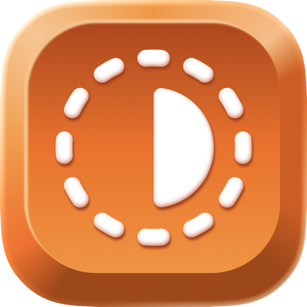
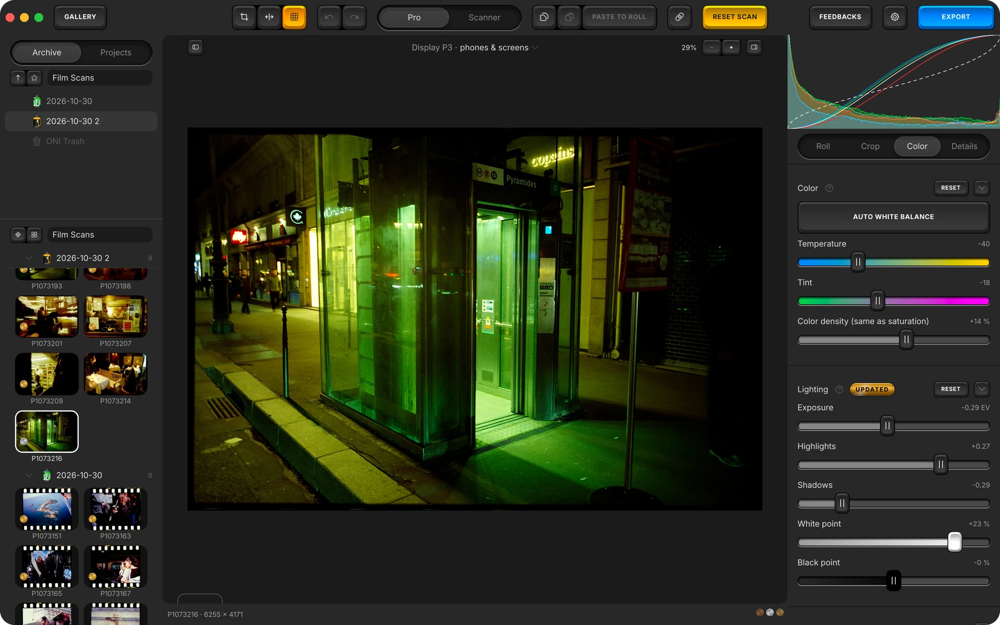
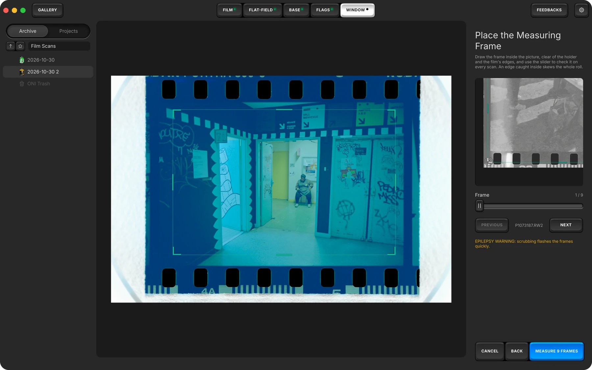
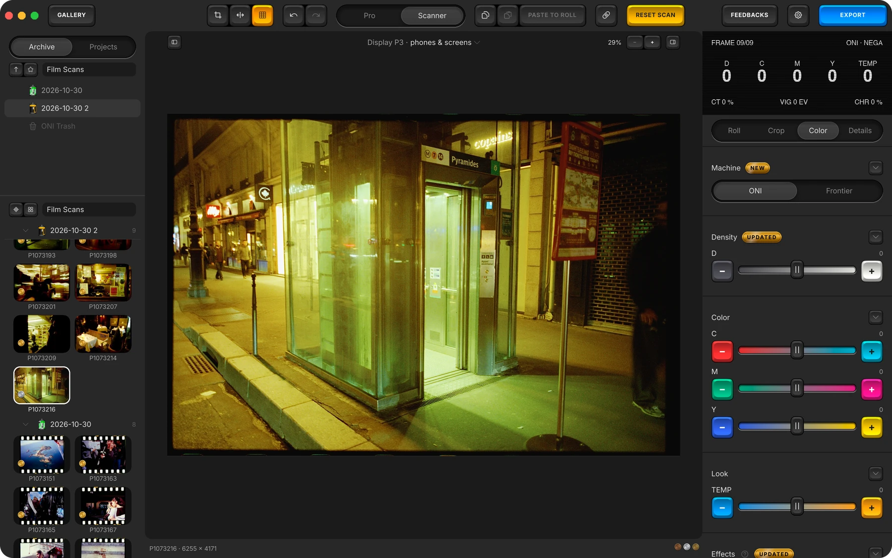
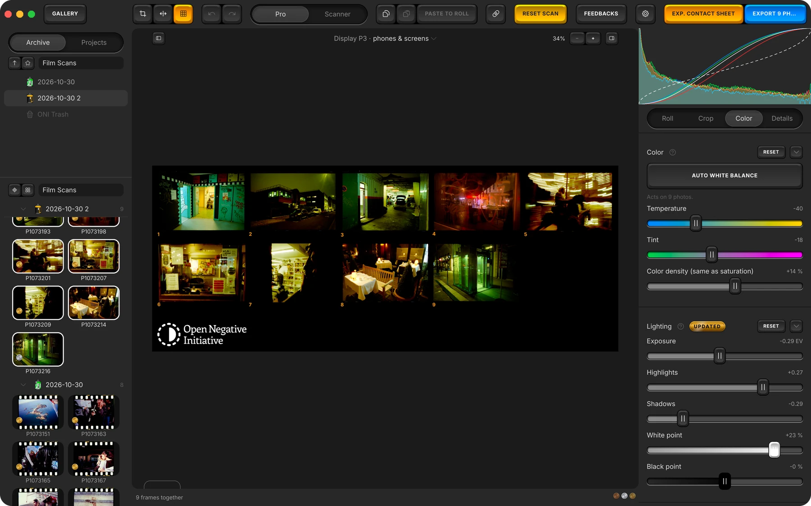
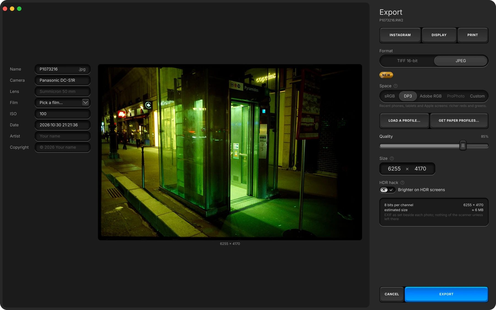

  

<h1 align="center">Open Negative Initiative</h1>

  Catalogue, convert and edit scanned film on Mac and Windows: colour negatives, slides and black &amp; white. 
  Each roll measured whole, its colour managed to the file. Free and open source.

  
  
  
  
  

  <!-- The Mac button goes through the website's /dl, which redirects to this repository's latest release;
       chain.yml watches that hop. -->
  <a href="https://open-negative-initiative.com/dl?t=readme"><strong>↓ Download for macOS</strong></a>
  &nbsp;·&nbsp;
  <a href="https://github.com/5e1y/open-negative-initiative-releases/releases/latest/download/ONI-windows.zip"><strong>↓ Download for Windows</strong></a>

  <a href="https://open-negative-initiative.com/">Website</a>
  &nbsp;·&nbsp;
  <a href="https://open-negative-initiative.com/guide">Quick guide</a>
  &nbsp;·&nbsp;
  <a href="https://open-negative-initiative.com/manual">Manual</a>
  &nbsp;·&nbsp;
  <a href="https://open-negative-initiative.com/changelog">Changelog</a>
  &nbsp;·&nbsp;
  <a href="https://github.com/5e1y/open-negative-initiative-releases/releases">All versions</a>
  &nbsp;·&nbsp;
  <a href="https://github.com/5e1y/open-negative-initiative-rs">Source code</a>
  &nbsp;·&nbsp;
  <a href="https://ko-fi.com/remicourtillon">Donate</a>

  

---

## What it does

- **Measures a roll as a whole.** Prepare the Roll walks you through five steps: the film and what
  digitised it, a flat-field from a shot of the empty light panel, the film base picked under a
  loupe, the frames to leave out of the measurement, and one measuring frame. The roll's colour then
  sits on the median of its frames and its ends on a trimmed median, so the roll follows its typical
  frames and a tinted or fogged frame follows the roll.
- **Inverts in optical density**, channel by channel, and opens the editor on your roll already
  converted, one undo step away from where it was.
- **Manages colour to the file.** You edit in the space you export in, sRGB, Display P3, Adobe RGB,
  ProPhoto RGB or a paper's ICC profile, and the canvas is drawn as the export will write it.
  Floating point from the decode to the export.
- **Leaves every decision to you.** Auto White Balance runs when you press it, leaves its result on
  two sliders for you to adjust, and undo takes it back. Film stock, crop and preset are your gestures
  too.
- **Keeps your originals as they are.** Point it at the folder that holds your scans: its folders are
  the archive, your files stay where they are, and each photo's settings live in a small JSON
  sidecar beside it.
- **Works the same on both systems.** The same render pipeline on the GPU, the same RAW decoding
  through LibRaw and the same colour engine on a Mac and on a PC.

  

## Features

The list below is the short one. [Every feature, line by line](https://open-negative-initiative.com/features)
is on the website.

**Open your scans**

- **Camera RAW** in about forty formats (NEF, CR2, CR3, ARW, RAF, DNG, RW2, ORF, PEF, IIQ, 3FR, X3F
  and more) through LibRaw, in the same colours on Mac and on Windows.
- **Nikon High Efficiency NEFs** (HE and HE\*) converted to lossless DNGs in one click, through Adobe
  DNG Converter, which the app downloads from Adobe and installs for you when it is missing.
- **Scanner files**: linear DNG and linear TIFF, large 16-bit TIFFs of 45 megapixels and more, and
  JPEG, PNG, GIF, BMP and WebP.
- **RGB Passes**: three shots of one frame under red, green and blue light read as one frame, the red
  and blue passes registered on the green one.

**Prepare the roll**

- **A flat-field** from any picture of the empty light panel, applied first, whatever the crop, and
  kept for every later roll.
- **The film base** from your click on bare film, with a loupe at full resolution.
- **Flags** for light leaks, a cut first frame or extreme shots: they are converted with the roll
  while the measurement reads the others.
- **Slides** balanced on a white or grey you click: a cloud, a wall or the bare light through a
  sprocket hole. Without a click they keep the camera's 5500 K.
- **41 film stocks** by brand and **five dye families**: Kodak C-41, Fuji C-41, Generic C-41, ECN-2
  for cine film and E-6 for slides.

**Convert**

- **The Roll tab** holds what a roll shares: film type, Source Balance, Density Ceiling, Per-Channel
  Levels with five handles per channel, Dye Separation and Balance Strength. Moved on one photo, a
  setting reaches every photo measured with it, each keeping its own look, in one undo step.

**Edit a photo**

- **Color.** Auto White Balance, Temperature and Tint, which move colour alone with brightness held,
  and Color density.
- **Lighting.** Exposure from −4 to +4 EV, a full stop per EV in the shadows while the highlights
  roll smoothly toward white, coupled to colour by Hunt compensation. Highlights, Shadows, White
  point and Black point.
- **Finishing.** Contrast, Vignette and Chrome, Curves on five channels, Spectrogram Finishing on
  eight colour ranges and a Saturation Curve.
- **Crop.** 3:2, 4:3, 1:1, 6:7, 5:4 or free, straighten ±8°, quarter turns and mirror, with a framing
  of its own to copy and paste across a roll.
- **Details.** Sharpening on brightness alone, Chroma Denoise that smooths colour noise while the film
  grain stays, Texture, and a loupe at full resolution.
- **De-dust.** Paint over a defect and ONI covers it with a patch copied from the same photo, found
  by a search for the place whose surroundings best match your stroke. Every correction stays in an
  editable list on the photo.

**The Scanner face**

- **A second face for every photo**, switched from the bar: a lab scanner's machine and keypad in
  place of the slider panel, with D for density and C, M and Y toward a colour, each click a density
  step measured on the machine.
- **Two machines**: ONI, the app's own conversion, and Frontier, which reproduces the colour of a
  Fujifilm Frontier lab scanner, measured on the machine. Export the look as a standard `.cube` LUT,
  or edit it in any LUT tool and watch it reload.

  

**Several photos at once**

- **Edit frames together.** Selected frames open on one sheet, and every adjustment on the open frame
  lands on all of them in the same undo step, each keeping its own crop, dust and measurement.
- **Copy, Paste and PASTE TO ROLL** carry the Color and Details settings.
- **Presets** carry the settings you tick, preview on your photo as the pointer hovers their card, and
  travel as a file or as one line of text to paste in a message.

  

**Proof and export**

- **Soft-proofing** on a printer or paper profile, showing the paper's own white and its ink's black,
  with Paper Correction so a grey prints as grey. The app lists where twelve paper makers and labs
  publish their profiles.
- **16-bit TIFF**, uncompressed or with lossless ZIP, and **8-bit JPEG**, with three presets:
  Instagram, Display and Print.
- **An HDR gain map** on JPEG: an HDR screen shows the picture up to two stops brighter, and every
  other reader shows the same picture.
- **EXIF per frame**: camera, lens, film, ISO, date, artist and copyright, the fields you state.
- **Contact sheets** of a selection or a whole roll, numbered by their place on the film.

  

**The archive**

- **The folders on your disk are the archive.** Rolls live inside them and travel with them, marked
  with their film stock's artwork. Favourite folders, every disk, and a held place for a folder on an
  unplugged disk.
- **Projects** gather photos from any folder, each photo staying in its own.
- **Medals**, Bronze, Silver and Gold, on the bare keys 1 to 3, with a filter in the gallery.
- **Undo** up to 200 steps per photo, and an ONI Trash that leaves every file in its folder.

**The app**

- **In English, French and Spanish**, following your system's language or your choice.
- **A short demo clip** for every "?" help note, filmed from the real controls over the real render.

## Installing

**On a Mac:** macOS 13 or later, on Apple Silicon or Intel, one universal build for both. Open
`OpenNegative.dmg`, drag the app onto the Applications folder beside it, eject the disk image and
open the app from Applications. If macOS says it cannot verify the app, open **System Settings →
Privacy & Security**, scroll to the bottom and click **Open Anyway**.

**On Windows:** Windows 10 or 11, 64-bit. Unzip `ONI-windows.zip` anywhere, Documents or the Desktop,
and open `ONI.exe` inside the folder. If SmartScreen says it protected your PC, because the build is
not signed, click **More info**, then **Run anyway**.

**Updates:** on both systems the app looks for updates on its own and asks you before installing one.
It verifies the signature first and keeps the previous version ready if the swap fails. On Windows
this starts with version 1.5.3: if your copy is older, download the current version once, unzip it as
you did the first time, and the app takes it from there.

## Reporting something

The **FEEDBACKS** key in the app opens an issue here with no account at all. You can also open an
[issue](https://github.com/5e1y/open-negative-initiative-releases/issues) on GitHub. Two things make
a report usable: **the version**, shown in Settings under About, and **the RAW file** if it is a
colour or decoding problem. A screenshot shows the symptom, the file reproduces it.

## Source code

This repository holds the builds, their release notes and the update feeds. **The code lives in the
working repository, [5e1y/open-negative-initiative-rs](https://github.com/5e1y/open-negative-initiative-rs)**:
Rust, `wgpu` and WGSL kernels, Slint for the interface and LibRaw for RAW decoding. That is the place
to read it, build it or fork it.

Open Negative Initiative is **GPL-3.0**, and **every release also carries the complete source it was
built from**, attached to that release as `OpenNegative-<version>-source.zip`. Versions up to 1.3.1
carry the earlier Swift app the same way.

**Take the file with `-source` in its name.** The "Source code (zip)" GitHub attaches on its own
archives *this* repository, the builds and the feeds.

How the app works, stage by stage and with the research behind it, is written on
[the website](https://open-negative-initiative.com/features), and
[the source page](https://open-negative-initiative.com/open) says what the licence gives you.
